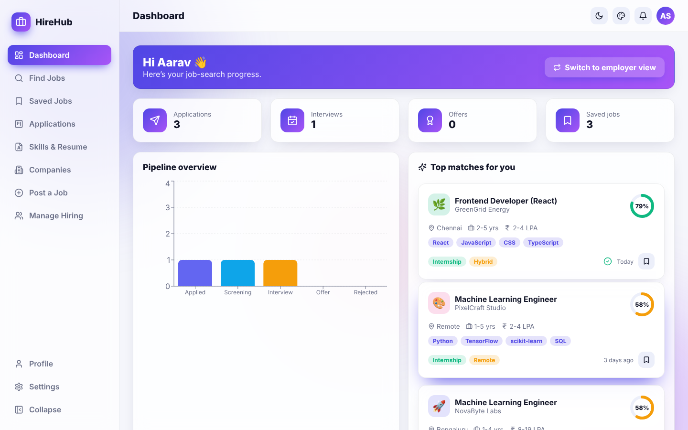
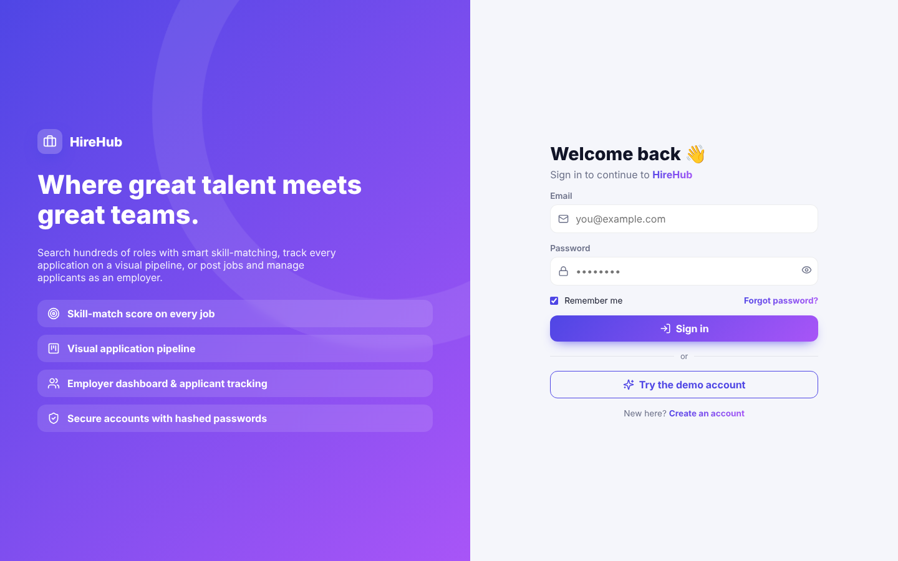
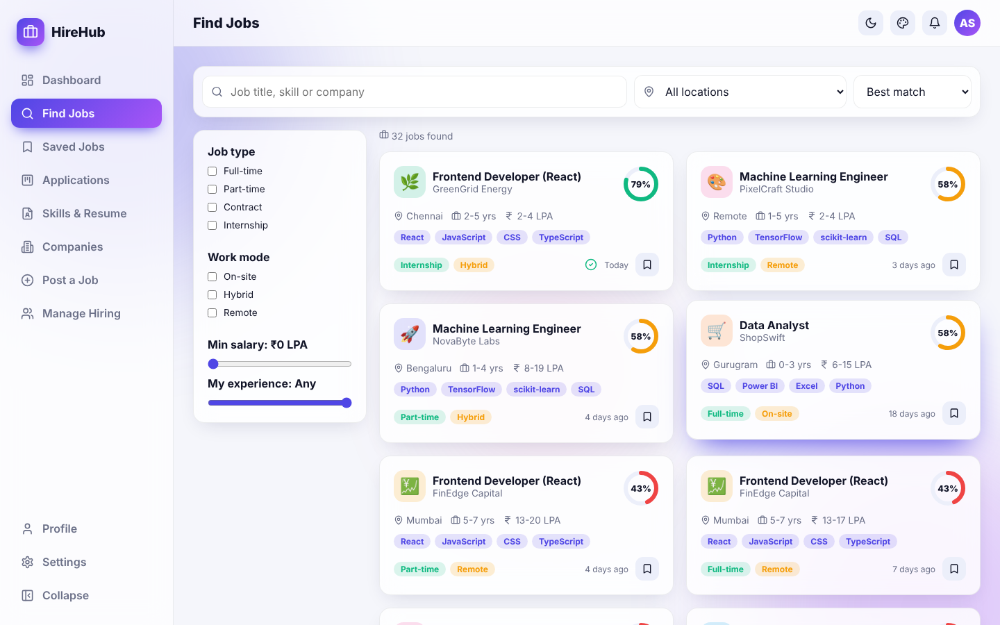
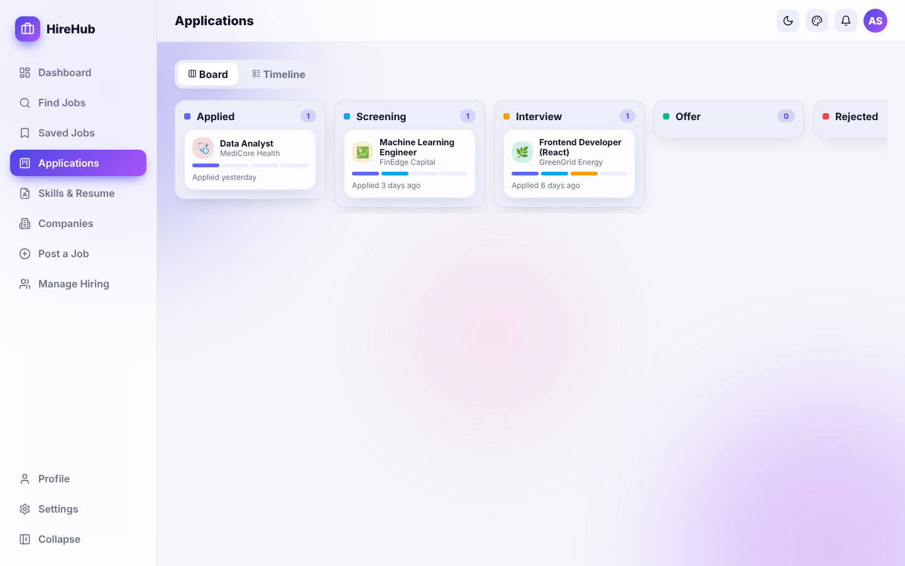

<div align="center">

# 💼 HireHub

### Smart job portal for job seekers **and** employers — skill-match scoring, visual application pipeline & applicant tracking


</div>



## ✨ Features

| Area | What you get |
|---|---|
| 🔐 **Auth** | Register as **Job seeker** or **Employer**, salted SHA-256 password hashing, strength meter, remember-me, demo account, protected routes, profile & password management |
| 📊 **Dashboard** | Role-aware KPIs with count-up animation, pipeline bar chart, top skill-matched jobs (seeker) or latest applicants (employer), one-click role switch |
| 🔎 **Find Jobs** | Search by title/skill/company, location, job type, work mode, salary & experience filters, removable filter chips, 4 sort modes (best match, recent, salary, popular) |
| 🎯 **Skill matching** | Animated match-score ring on every job, computed from your resume skills + experience; job details show ✓/✕ per required skill and tips to improve |
| 📝 **Quick apply** | Cover note, expected CTC, notice period, portfolio link; duplicate-application guard |
| 🗂️ **Applications** | Kanban board by stage (Applied → Screening → Interview → Offer / Rejected) and a timeline view with dated status history; withdraw |
| 📄 **Resume builder** | Headline, experience, education, links, skill tags with suggestions, profile-strength meter and live preview card |
| 🏢 **Companies** | Directory with ratings, size, industry and open-role counts; company detail modal |
| 🚀 **Post a Job** | Full job form with brand colour/logo and a live preview card |
| 👥 **Manage Hiring** | Postings list, applicant table, move candidates between stages, close/reopen or delete jobs |
| 🎨 **Themes** | Light / Dark / Midnight / Sepia / System · 6 accents · radius slider · compact & reduced-motion modes |
| 🎞️ **Animations** | Gradient blobs, page transitions, staggered cards, animated SVG rings, shimmer buttons, pop-in modals, toasts |

## 🖼️ Screenshots

| Login | Find Jobs | Applications |
|---|---|---|
|  |  |  |

## 🚀 Getting started

```bash
git clone https://github.com/PreciousBharath/HIREHUB-SMART-JOB-PORTAL.git
cd HIREHUB-SMART-JOB-PORTAL
npm install
npm run dev
```

Demo login: `demo@hirehub.app` / `Demo@1234` (switch to the employer view from the dashboard), or register a new account.

## 🧱 Structure

```
src/
├── data.js        # Companies, seeded jobs, pipeline stages, match-score algorithm
├── hub.jsx        # Jobs, applications (shared), saved jobs & resume (per user)
├── auth.jsx · theme.jsx · toast.jsx · storage.js
├── components/    # Job (JobCard, JobModal, MatchRing), Layout, ThemePanel, StatCard…
└── pages/         # Dashboard, Jobs, Applications, Resume, Companies, PostJob, Manage, Login, Register…
```

## 🛠️ Tech stack

React 18 · React Router 6 · Recharts · Lucide icons · Vite · SVG animations · Web Crypto API · localStorage

## 📄 License

MIT © [Bharath](https://github.com/PreciousBharath)
